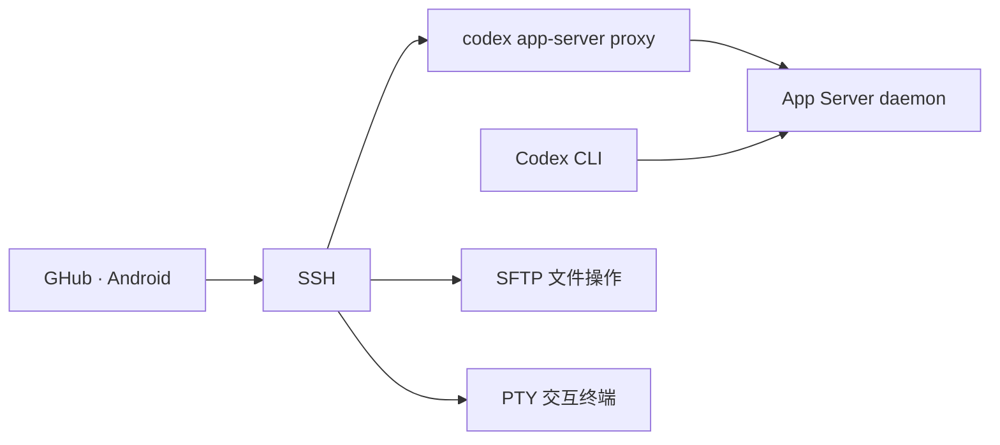

# GHub 任务看板

面向墨水屏的 Android 远程任务看板，基于 GHub 和提供的「Ocean 5C 竖屏」HTML 改造。

首页采用随 APK 打包的 HTML / CSS / SVG，通过原生桥接读取真实远端任务，提供等待确认、执行中、已完成和已失败四个状态页。OpenSSH 连接、凭据管理、SFTP、PTY 终端以及会话详情沿用 Kotlin / Compose 实现。仅连接 OpenSSH 时可使用文件和终端；远程任务、计划和审批由 Codex App Server 提供。

[](LICENSE)
[](docs/getting-started.md)

[看板使用与实现说明](docs/taskboard.md) · [APK 构建与下载](https://github.com/chen-yu-hao/GHub/actions/workflows/taskboard-apk.yml) · [离线 UI 对照](app/design/taskboard/preview.html) · [测试记录](docs/taskboard-verification.md) · [原项目](https://github.com/iawnix/GHub)

本次改造维护在 [chen-yu-hao/GHub 的 main 分支](https://github.com/chen-yu-hao/GHub/tree/main)，基于上游提交 `2686cf23d8c6d6d47086e38477cb27411cc768f4`。当前版本 **`0.2.2-taskboard`（versionCode 44）**、[源码 `5bd7f89`](https://github.com/chen-yu-hao/GHub/commit/5bd7f89f0040932d5aed039e563b3faadd303dcd) 修复横竖屏显示不完整：原生 WebView 显式填满窗口，看板取消全局宽高硬限制，短屏使用整页滚动，正常高度保留任务区内部滚动；旧 Android 在旋转后丢失全屏标志时恢复看板的系统栏状态。

**同一提交的 [APK 构建 41437823444](https://github.com/chen-yu-hao/GHub/actions/runs/41437823444) 与 [完整 CI 41437406135](https://github.com/chen-yu-hao/GHub/actions/runs/41437406135) 均成功。** API 29 / 35 / 36 每档实际 35 项通过、4 项 fixture 跳过；新增布局用例执行竖屏 → 横屏 → 返回竖屏、真实滑动和分页。独立核对三档共 36 份几何 JSON 与 36 张原始 PNG，所有捕获的请求尺寸、全屏状态和滚动结果通过；API 29 返回竖屏实际保持 632 × 840。前端 32 项、JVM 76 项及 Release 的加密密钥、SFTP、PTY 综合用例通过，另有 7 项 JVM fixture 跳过，详见[验证记录](docs/taskboard-verification.md)。

安装包已下载核对，采用独立包名 `dev.remotegpt.taskboard` 和 Debug 调试签名，可与原版共存。Ocean 5C 真机像素、中文字体和硬件全刷仍需实机确认；上游 Releases 的 APK 不包含本次改造。

**从旧预览版升级时，请先保存服务器配置、认证材料和需要的本地数据。** 已核验的 0.2.0、0.2.1 与本次 0.2.2 Debug 证书不同，不能常规覆盖安装；卸载旧预览版后重装会清除其本地配置和数据。证书比对范围及安装说明见[验证记录](docs/taskboard-verification.md#apk-下载签名与升级)。

## 功能

- **HTML 看板首页**：以 632 × 840 为对照画布，保留附件的布局、卡片、图形和状态色；四个状态页每页分别为 2 / 3 / 7 / 2 项。
- **真实任务状态**：跨服务器和项目筛选、分页、继续加载、手动同步、可见期间每 5 分钟同步；真实审批、结构化计划、结果和失败信息。
- **墨水屏交互**：高对比边框、彩色 / 黑白切换、按秒合并流式界面更新、有限黑白页面重绘；硬件波形刷新待 Ocean 5C 真机接入验证。
- **独立 SSH 可用性**：任务服务未就绪时，已经建立的 OpenSSH 连接仍可用于文件与交互终端。
- **会话工作台**：按服务器和项目组织会话，支持新建、归档、历史记录、模型与思考级别选择。
- **任务与审批**：接收流式回复，查看执行过程、命令输出和文件改动，在手机上处理命令与文件审批。
- **代码阅读**：Markdown、语法高亮、Diff、自动换行和全屏阅读，命令与输出可分别复制。
- **远程文件**：通过 SFTP 浏览、上传、下载、预览图片和编辑文本，保存时检查远端修改。
- **交互终端**：支持 Vim、tmux、多个终端、组合键、双指缩放和横屏输入。
- **连接与输入**：多级 SSH 跳板、密钥与密码认证、断线重连、本地草稿、图片附件和系统语音输入。
- **原生管理界面**：Kotlin、Jetpack Compose、Material 3；服务器、设置与会话详情保留中文、English 和深浅色主题，看板按提供的中文浅色设计实现。

## 界面预览

用浏览器打开 [app/design/taskboard/preview.html](app/design/taskboard/preview.html)。预览引用生产 CSS、SVG 与 JavaScript，显式使用示例数据，不连接服务器、不执行命令。原 HTML 提取内容和尺寸对照见[设计说明](app/design/taskboard/README.md)。尚未完成 Ocean 5C 真机与参考 HTML 的像素、字形和硬件全刷验证。

## 快速开始

需要 Android 10 或更新版本和可通过 OpenSSH 访问的 Linux 主机。远程任务功能按上游兼容策略要求 Codex CLI **0.164.0 或更新的 0.x 版本**；SFTP 文件和 PTY 终端不要求任务服务成功启动。

1. 打开 [成功的 0.2.2 APK 构建运行 41437823444](https://github.com/chen-yu-hao/GHub/actions/runs/41437823444)，从 **Artifacts** 下载 `ghub-taskboard-debug-apk`，解压并安装 `app-debug.apk`。已核验的下载文件保存为 `GHub-taskboard-0.2.2-5bd7f89-debug.apk`，共 78,982,267 字节；SHA-256 见[验证记录](docs/taskboard-verification.md#apk-下载签名与升级)。如已装旧预览版，先按上方说明保存数据再重装。
2. 要使用远程任务，在开发机完成 Codex 登录或模型提供方配置，启动 App Server：

   ```sh
   codex app-server daemon bootstrap
   codex app-server daemon version
   ```

3. 打开看板顶部筛选面板中的服务器管理，添加 SSH 地址、端口、用户和认证信息，核对主机指纹后连接。
4. 从看板筛选服务器和项目，查看任务、确认审批或进入「项目与会话」创建任务。纯 SSH 场景可选择服务器后打开终端；文件操作从原生项目菜单进入。

电脑端使用 `codex --remote unix://` 连接同一用户的默认 daemon，即可与手机接续同一会话。多级跳板、Codex 路径和连接排障见[使用指南](docs/getting-started.md)。

## 工作方式



任务在开发机上运行，手机负责交互和状态同步。SSH 凭据在本机通过 Android Keystore 加密保存；诊断由用户主动导出。原有连接恢复与后台行为见[连接与同步](docs/connection-recovery.md)。纯 SSH 模式在 Codex 不存在且连接随后丢失或被后台释放时需要手动重连，详见[看板说明](docs/taskboard.md)。

## 从源码构建

准备 JDK 21、Android SDK Platform 36、Build Tools 35.0.0 和 Node.js 22。复现已交付 APK 的源码版本可运行以下命令；设备验收使用的测试提交与模拟器配置见[验证记录](docs/taskboard-verification.md#复现构建与设备测试)：

```sh
git clone --branch main https://github.com/chen-yu-hao/GHub.git
cd GHub
git switch --detach 5bd7f89f0040932d5aed039e563b3faadd303dcd
node scripts/taskboard/board.test.cjs
./gradlew -PpreviewApplicationId=dev.remotegpt.taskboard \
  :codex-client:test :app:testDebugUnitTest :app:lintDebug :app:assembleDebug
```

APK 位于 `app/build/outputs/apk/debug/app-debug.apk`。仓库提供 [Build taskboard APK](https://github.com/chen-yu-hao/GHub/actions/workflows/taskboard-apk.yml) 工作流；有权限时可在 Actions 中选择 **Run workflow** 构建选定分支。下载前核对运行的提交与结论，构建、设备交互和布局检查分别记录。更多环境配置见[开发指南](docs/development.md)。

## 参与贡献

欢迎通过 [Issues](https://github.com/iawnix/GHub/issues) 反馈问题或讨论功能，也欢迎改进代码、文档和翻译。提交前请阅读[贡献指南](CONTRIBUTING.md)。

## 许可证

GHub 使用 [GPL-3.0-only](LICENSE) 许可证。终端组件基于 [Termux](https://github.com/termux/termux-app)，完整依赖声明见 [THIRD_PARTY_NOTICES.md](THIRD_PARTY_NOTICES.md)。

GHub 是社区项目，与 OpenAI 无隶属关系。
